<div align="center">


# 灵屿 · AuraIsle

**一座悬浮在屏幕边缘的原生桌面灵动岛，收纳你的日常节奏、系统遥测与 AI 工作流。**

基于 **Rust + egui / eframe (`wgpu` Direct3D 12 / Vulkan & WGL/OpenGL)** 构建的原生 Windows 桌面信息岛，零 Electron / WebView 重型运行时开销，将媒体歌词、AI Agent 状态与额度看板、消息通知聚合、交互周课表、硬件实时监控、街道级天气、图文剪贴板与无线外设电量无缝收拢于指尖。

[](https://github.com/Eternal3240/Auralsle/releases/latest)
[](https://github.com/Eternal3240/Auralsle/releases/latest)
[](#从源码构建)
[%20%7C%20Vulkan-6366F1?style=flat-square)](#图形字体与窗口引擎)
[](LICENSE)

[核心特性](#-核心特性总览) · [实机图鉴](#-全模块实机图鉴) · [设备胶囊](#-无线外设与四态设备胶囊) · [安装与更新](#-安装与更新) · [从源码构建](#-从源码构建) · [数据与隐私](#-数据与隐私) · [开源致谢](#-开源许可与致谢)

<br />

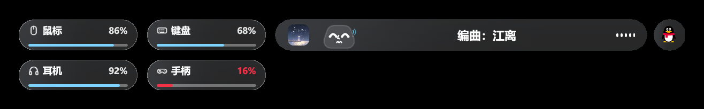

<sub>▲ 顶部收起态实机渲染：左侧为四合一无线外设电量胶囊（支持低电红色预警），中部为专辑封面 + 矢量吉祥物 + 逐字歌词摘要，右侧为通知应用微标。</sub>

</div>

---

## ✨ 核心特性总览

| 模块 | 能力亮点 |
| --- | --- |
| **🎭 形态、皮肤与动效** | 支持顶部 / 左侧 / 右侧三边停靠、刘海 / 胶囊双形态与多款主题皮肤（经典黑、奶油、毛玻璃浅/深、悬浮云、液态玻璃及 WinIslands 主题）；内置 **磁吸回弹 (`MagnetSpring`)**、**流光渐显 (`AnimatedContent`)** 与 **平滑滑动** 三套切页动效。 |
| **🤖 AI 工作状态与额度** | 实时监听 **Claude Code / Codex / Gemini Antigravity / 豆包 / WorkBuddy / DeepSeek** 会话与进程生命周期；支持岛内呼吸灯、吉祥物联动及 `Ctrl+Alt+Y/N/T` 全局快捷审批；多服务商 AI 剩余额度与重置周期一处总览。 |
| **🎵 媒体控制与逐字歌词** | 接入 Windows SMTC，并深度适配网易云音乐、QQ 音乐、酷狗、汽水音乐、波点与 Apple Music；支持横条 / 卡片 / 舞台三态展开与收起态歌词。 |
| **💬 消息聚合与通知历史** | 微信多开分账号未读角标、QQ 与办公软件（企业微信/飞书/钉钉）通知聚合；自动识别并遮罩验证码；通知历史按应用分组，支持免打扰与一键清理。 |
| **📋 置物架与图文剪贴板** | 临时文件拖放中转站 + 最多 30 条图文剪贴板历史；播放音乐期间近期复制可一键直达剪贴板；支持「鼠标离开 / 点击空白处 / 延时收起」三种闭岛策略。 |
| **🖥️ 统一设备与亮度调控** | 将 **DDC/CI / WMI 显示器亮度** 与 **蓝牙 / 2.4GHz 无线外设（鼠/键/耳/柄）** 收归统一「设备」管理；异步预热显示器列表，亮度岛按设备数量自适应短岛/长岛/滚动列表。 |
| **⚡ 硬件遥测、天气与翻译** | 内置 Glance 风格系统曲线/圆环/分栏监控、街道级 24H 天气趋势卡（Open-Meteo）、交互式周课表（`.xlsx` 导入）、多邮箱 IMAP 验证码识别及多引擎 AI 翻译。 |
| **🧩 现代 Twinkle 设置中心** | Win11 自绘无边框圆角窗口（支持原生标题栏拖动、八向拉伸缩放与最大化自适应居中排版，默认 `1024×720` 即最小尺寸）、全站 `Ctrl K` 实时搜索、四次缓出非线性平滑滚动，以及内嵌 `MiSans Latin` + 多语言零乱码字体链。 |

---

## 📸 全模块实机图鉴

### 1. 自绘圆角设置中心、全局搜索与通知历史
- **现代设置框架**：无边框圆角窗口支持 `Ctrl K` 快捷搜索定位设置项、五子类拆分式「常规」设置与 `120Hz` 四次缓出平滑滚动，放大或最大化后自动自适应扩展阅读栏宽并保持左右边距对称。
- **通知与提醒历史**：自动汇总系统通知与应用消息，支持按应用折叠查看、快速定位验证码大卡及一键清空记录。

<p align="center">
  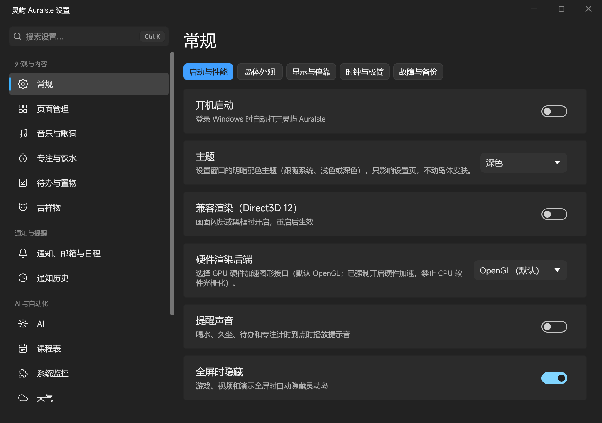
  &nbsp;
  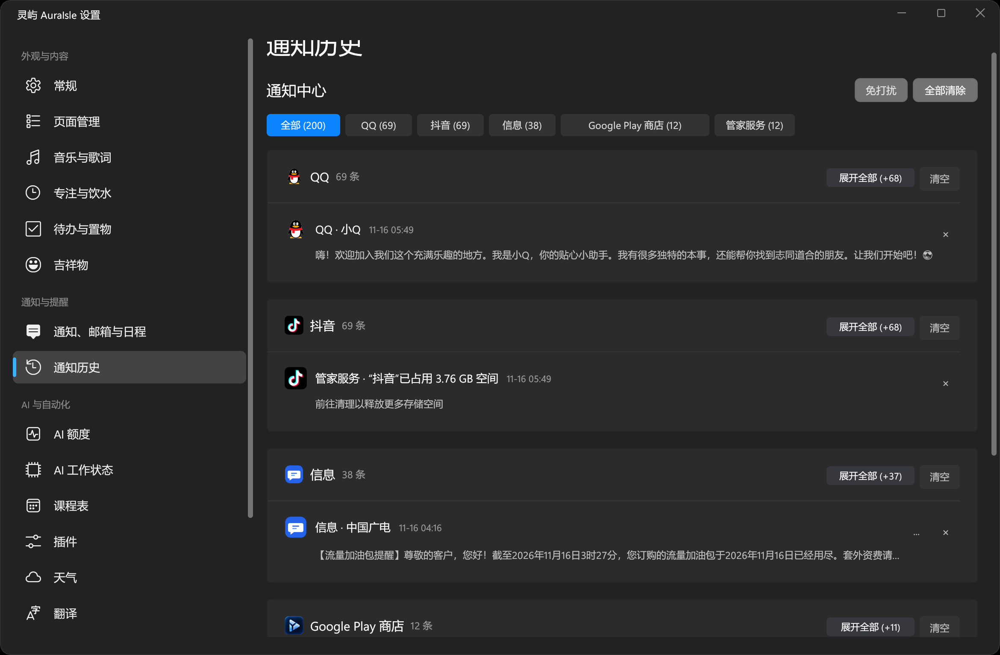
</p>

---

### 2. Aora Bot 全形态矢量吉祥物工坊 & 图文剪贴板
- **吉祥物工坊**：内置 **72 款形态**（完整移植 Aora Bot 13 个角色家族 71 款核心身体形态 + 原创 `Islo`）、**21 种矢量画风** 与 **44 种状态表情**，支持内部填充、外部轮廓与五官 RGBA 独立调色与十六进制微调。
- **置物架与剪贴板**：同时承载文件暂存拖拽与图文混合剪贴板，支持搜索筛选、备注与图片缩略图快速回填粘贴。

<p align="center">
  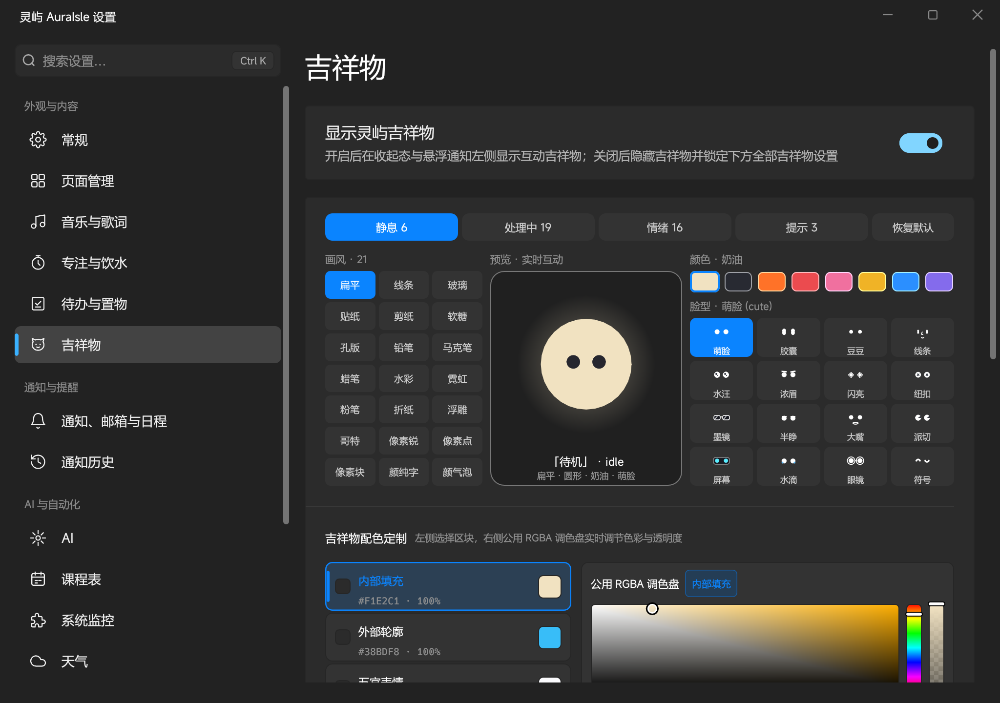
  &nbsp;
  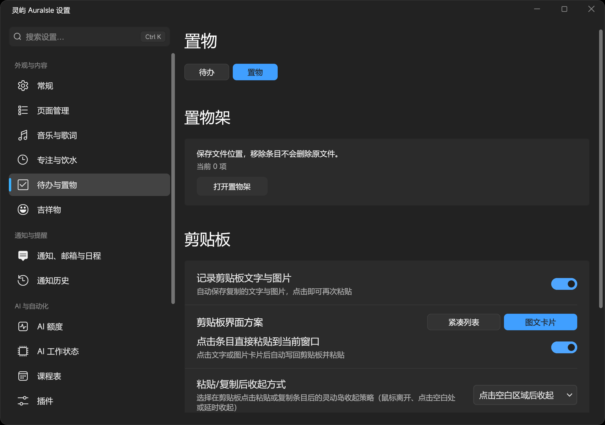
</p>

---

### 3. AI 额度看板 & AI Agent 工作状态联动
- **AI 额度**：集中查看 Claude、Codex、Gemini、豆包、Kiro、OpenCode Go、MiniMax、GLM 及主流中转站（New API / One API / Sub2API）账户余额与周期额度，可将常用账号钉选至收起态灵动岛。
- **AI 工作状态**：本地只读增量监听 AI 客户端会话与钩子状态，在岛内呈现工作态指示灯、等待确认卡片及全局快捷键审批（`Ctrl+Alt+Y` / `N` / `T`）。

<p align="center">
  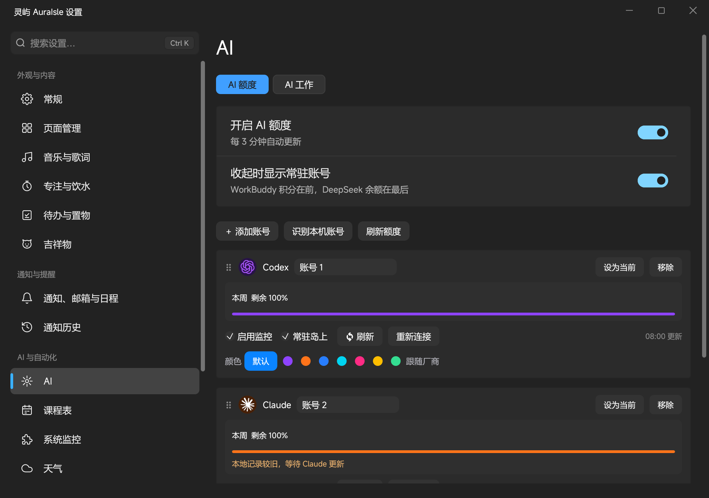
  &nbsp;
  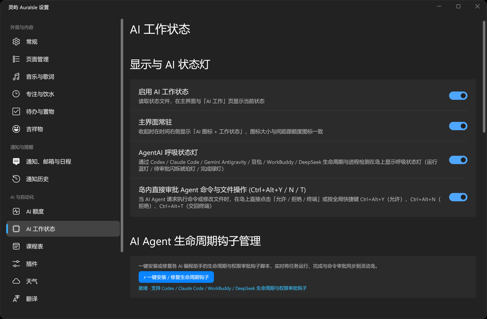
</p>

---

### 4. Glance 硬件监控、街道级天气、交互周课表与快捷翻译
每个功能页均在设置中内置 **实时交互预览卡片**：
- **插件（系统监控）**：支持「曲线读数卡 (`Curve`)」「极简圆环 (`Rings`)」「硬件分栏 (`Lanes`)」三形态实时遥测。
- **天气**：支持自动定位或指定城市，内置现代卡片式街道实况、24H 逐时温度曲线、空气质量、风况与日出日落进度。
- **课程表**：周视图格子直接编辑、校周切换、非本周课程灰显及 `.xlsx` 教务课表一键导入。
- **快捷翻译**：支持 DeepSeek / OpenAI / 硅基流动 / Gemini / Claude 多引擎与剪贴板自动检测。

<p align="center">
  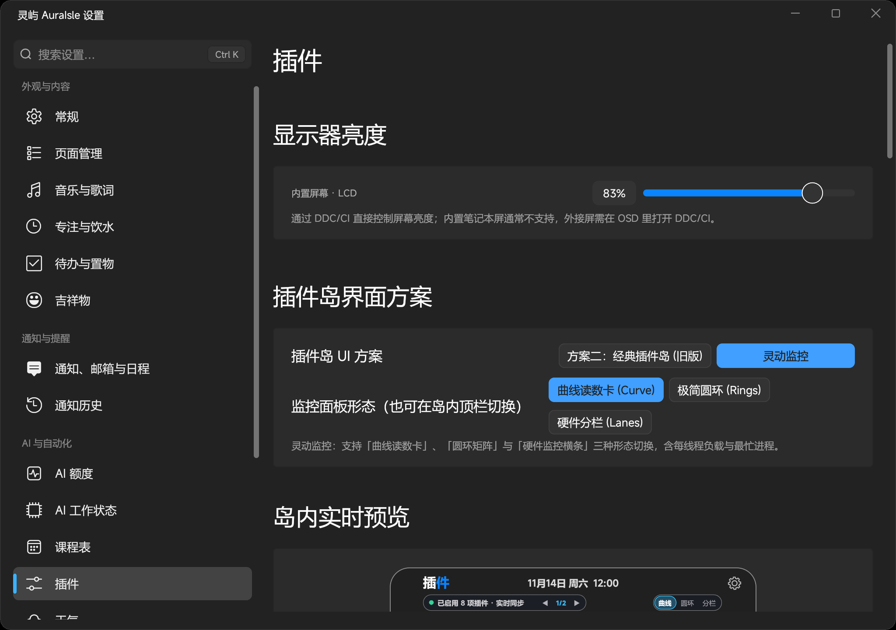
  &nbsp;
  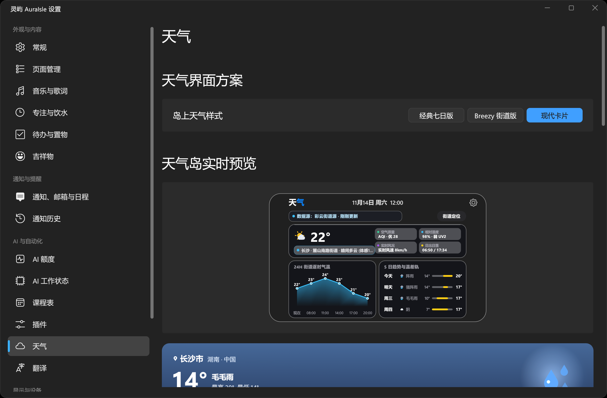
</p>
<p align="center">
  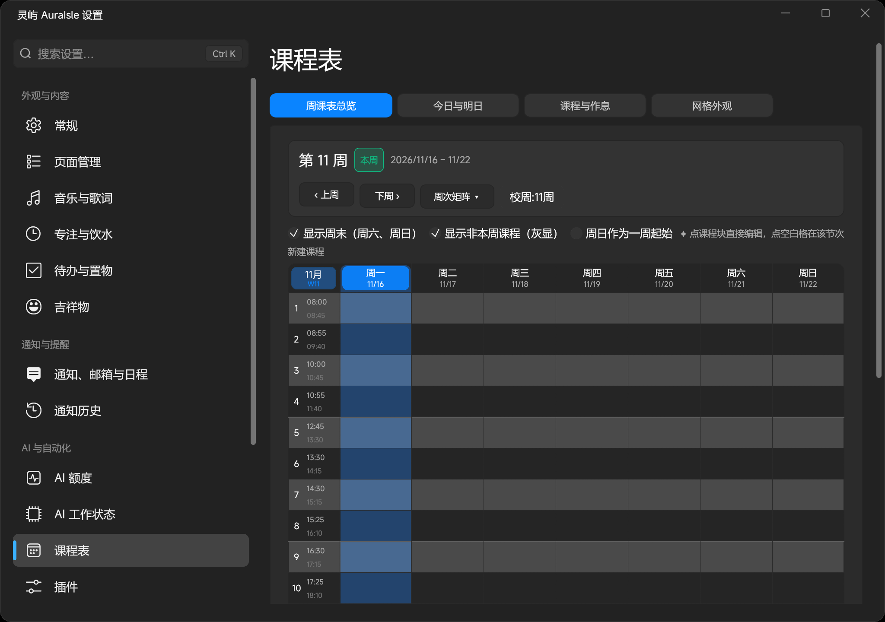
  &nbsp;
  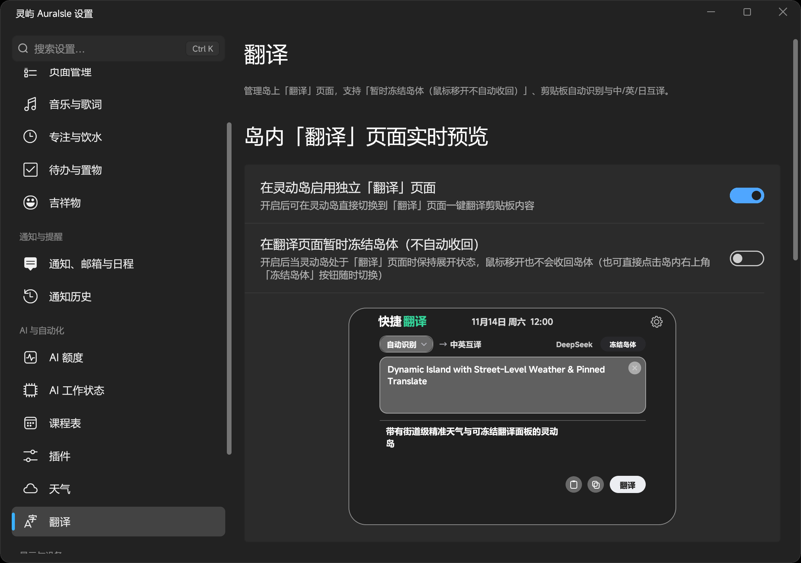
</p>

---

### 5. 统一设备管理、内存治理与开源关于页
- **设备中心**：将显示器的 DDC/CI / WMI 亮度调节与隐藏规则，和蓝牙 / 2.4GHz 无线外设电量统一收纳到「设备」分页，不再分散。
- **资源与功能模块总开关**：实时展示专用提交内存、物理工作集、线程/句柄与纹理/排版缓存；可随时按需一键停用单个模块并回收后台线程，点击「清理缓存并释放内存」异步整理工作集，不阻塞 UI。

<p align="center">
  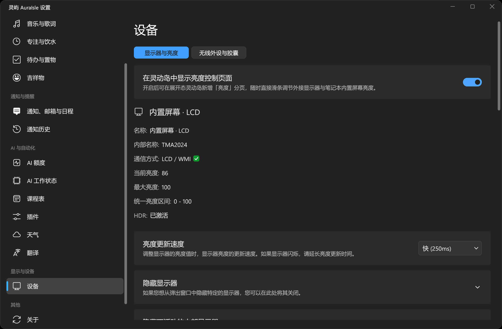
  &nbsp;
  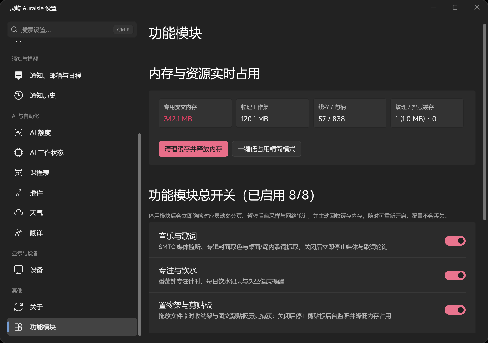
</p>
<p align="center">
  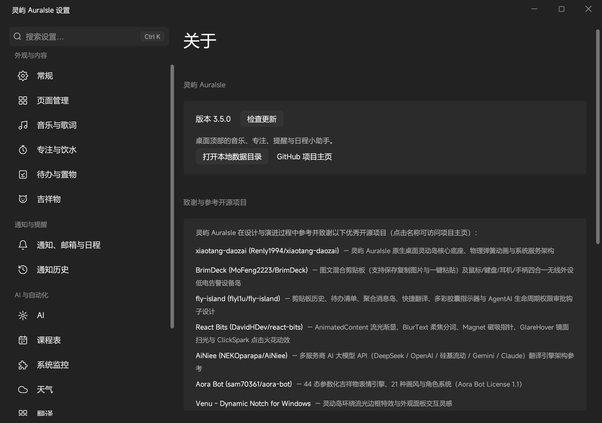
</p>

---

## 🔋 无线外设与四态设备胶囊

桌面侧翼外设胶囊（蓝牙 & 2.4GHz 鼠标 / 键盘 / 耳机 / 手柄）严格统一主岛圆角与深色玻璃材质，低电量（≤20%）自动切换红色警示条，并提供 **4 套全新 UI 样式** 自由切换：

<div align="center">
  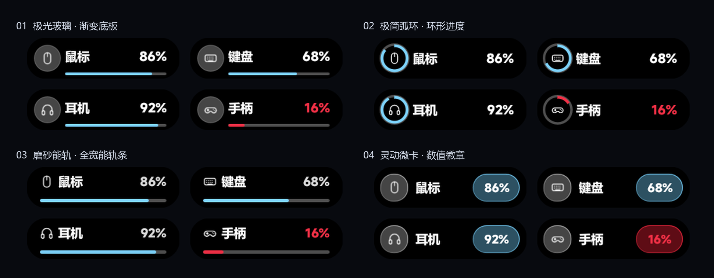
</div>

---

## ⚙️ 图形、字体与窗口引擎

- **多后端硬件加速与 4x MSAA**：支持在 **设置 → 常规 → 硬件渲染后端** 或环境变量 `AURALSLE_RENDERER`（`dx12` / `vulkan` / `glow`）切换底层 `wgpu` 与 OpenGL 管线；Direct3D 12 与 Vulkan 默认开启 **4x MSAA 硬件抗锯齿**，并在检测驱动崩溃时自动回退兼容后端。
- **高一致性多语言字体**：内置精简 `MiSans Latin`（Regular / Semibold / Bold）作为默认西文/数字字体，并映射 Windows 系统简繁中日韩泰印及表情字体，避免异国语言出现方框乱码，同时不占用额外私有堆内存。
- **自定义 Win11 无边框窗口**：设置窗保留原生 `WS_THICKFRAME` + `WM_NCHITTEST` + `WM_NCCALCSIZE`，支持标题栏流畅拖拽移动、系统贴靠、八向缩放及最小尺寸锁定（`1024×720` 起步可自由放大/最大化），无需外部 C/C++ 运行库即可单文件独立运行。

---

## 📥 安装与更新

- 前往 **[GitHub Releases](https://github.com/Eternal3240/Auralsle/releases/latest)** 下载安装包 `AuraIsle-Setup-v*-x64.exe` 或绿色便携压缩包 `AuraIsle-v*-windows-x64.zip`。
- 已安装用户可在 **设置 → 关于 → 检查更新** 内直接触发自动检测，校验 SHA-256 哈希后自动完成热升级替换。
- 自 **v2.0.1** 起可执行文件名为 `AuraIsle.exe`，配置与历史数据目录统一存于 `%APPDATA%\Auralsle`。
- **关于首次运行 Windows SmartScreen 提示**（未经过签名校验的本地/测试构建，Windows 会显示「Windows 已保护你的电脑 · 发布者未知」）：
  - 下载后先在同目录比对 `SHA256SUMS.txt` 校验文件完整性；
  - 点击弹窗里的 **「更多信息」→「仍要运行」**，或提前在 PowerShell 执行 `Unblock-File .\AuraIsle-Setup-v3.0.0-x64.exe`；
  - 维护者若拥有受信任 CA 颁发的 Authenticode 证书（`.pfx` 或证书指纹），可执行 `.\scripts\package.ps1 -SignPfxPath <cert.pfx> -SignPfxPassword <pwd>` 自动对主程序与安装包签名。

---

## 🛠 从源码构建

### 环境要求
- Windows 10 / 11 x64
- [Rust stable](https://rustup.rs/)（`x86_64-pc-windows-msvc` 工具链）
- Visual Studio C++ Build Tools & Windows SDK（打包安装程序另需 NSIS 3.x）

### 克隆、编译与运行

```powershell
git clone https://github.com/Eternal3240/Auralsle.git
cd Auralsle
rustup default stable-x86_64-pc-windows-msvc

# 构建 Release 主程序
cargo build --locked --target x86_64-pc-windows-msvc --release --bin AuraIsle

# 启动 灵屿 AuraIsle
.\target\x86_64-pc-windows-msvc\release\AuraIsle.exe

# 直接打开设置窗口（可配合 AURALSLE_SETTINGS_TAB 跳转指定分页）
.\target\x86_64-pc-windows-msvc\release\AuraIsle.exe --settings

# 一键验证运行库依赖并生成 dist/ 安装包、便携 ZIP 与 SHA256SUMS.txt
.\scripts\package.ps1
```

### 常用开发者环境变量

| 变量 | 说明 |
| --- | --- |
| `AURALSLE_RENDERER` | 强制指定图形后端：`dx12`、`vulkan` 或 `glow`（OpenGL） |
| `AURALSLE_SETTINGS_TAB` | 启动直达设置分页索引（`0` 常规、`5` 置物剪贴板、`9` 关于、`11` AI额度、`12` AI工作状态、`16` 通知历史、`17` 吉祥物、`18` 天气、`20` 设备、`21` 功能模块） |
| `AURALSLE_DEMO_DEVICES=1` | 注入模拟鼠标 / 键盘 / 耳机 / 手柄外设用于调试设备胶囊与亮度页 |
| `AURALSLE_PILL_PIN=1` | 常驻固定显示无线外设侧翼胶囊 |
| `AURALSLE_DATA_DIR` | 指定隔离的独立配置与日志数据目录 |

---

## 🔒 数据与隐私

- **纯本地存储**：设置、待办、课程表、饮水记录、剪贴板历史及本地诊断日志（`%APPDATA%\Auralsle\diagnostics\`）全部保存在本机，无远端埋点、遥测或后台静默上传。
- **凭据安全**：邮箱授权码与 API Key 存入 Windows 凭据管理器；浏览器会话使用 Windows DPAPI 加密保护。
- **零侵入策略**：识别密码管理器标记为敏感的剪贴板条目前自动跳过记录；只读读取微信/QQ 提醒与 AI 客户端状态文件，不修改第三方应用原始配置。

---

## 🙏 开源许可与致谢

本项目原创代码基于 **[MIT License](LICENSE)** 开源，第三方依赖与字体的完整版权声明见 [THIRD_PARTY_NOTICES.txt](THIRD_PARTY_NOTICES.txt)；参与贡献与版本记录请参阅 [CONTRIBUTING.md](CONTRIBUTING.md)、[CHANGELOG.md](CHANGELOG.md) 与 [SECURITY.md](SECURITY.md)。

**灵屿 · AuraIsle** 在演进过程中参考并致谢以下优秀开源项目与资源：

- **xiaotang-daozai** ([Renly1994/xiaotang-daozai](https://github.com/Renly1994/xiaotang-daozai)) — 原生桌面灵动岛核心底座、物理弹簧动画与系统服务架构
- **Glance** ([lulu-loopp/glance](https://github.com/lulu-loopp/glance)) — 磨砂玻璃上下曲线硬件监控与多形态音乐控件设计
- **BrimDeck** ([MoFeng2223/BrimDeck](https://github.com/MoFeng2223/BrimDeck)) — 图文剪贴板与四合一无线外设低电设备胶囊交互参考
- **fly-island** ([flyl1u/fly-island](https://github.com/flyl1u/fly-island)) — 剪贴板历史、消息聚合、快捷翻译与 Agent 审批钩子思路
- **React Bits** ([DavidHDev/react-bits](https://github.com/DavidHDev/react-bits)) — `AnimatedContent`、`MagnetSpring`、`ClickSpark` 等动效灵感
- **shadcn/ui** ([shadcn-ui/ui](https://github.com/shadcn-ui/ui)) — 现代极简卡片容器与视觉层级规范
- **Voltide** ([sdparklab/Voltide](https://github.com/sdparklab/Voltide)) — 2.4GHz / 蓝牙无线外设电量胶囊样式参考
- **AiNiee** ([NEKOparapa/AiNiee](https://github.com/NEKOparapa/AiNiee)) — 多服务商 AI 大模型翻译引擎架构参考
- **Aora Bot** ([sam70361/aora-bot](https://github.com/sam70361/aora-bot)) — 44 态参数化矢量吉祥物表情、21 种画风与角色形态系统
- **MiSans Latin** — 内置西文与数字排版主字体

<div align="center">

如果 **灵屿 · AuraIsle** 让你的 Windows 桌面更加趁手，欢迎在 **[Eternal3240/Auralsle](https://github.com/Eternal3240/Auralsle)** 点亮 **Star** ⭐

</div>
